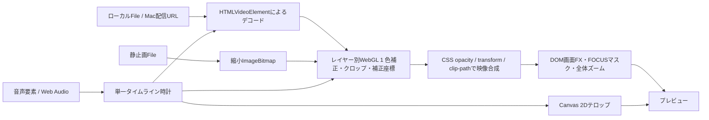

# PVE 動画処理アーキテクチャ・性能監査

調査日：2026-10-22。対象：PVE 2.2.80、コミット `54c7cf28889eecd79b9d4a7491314f9b6213f7ea`。

## 調査範囲と判断の読み方

公開版の処理経路をソースから追跡した静的調査です。ローカルの未公開 `dist/lab/`、`feature-lab.html` は現行機能に含めていません。調査時にあった `.gitignore`、`package.json` 等の試作関連変更は調査対象の動作に取り込んでいません。アプリコード、依存関係、設定、公開物は変更していません。

- **確認事実**：コードに存在する呼び出し、条件、データ構造、公式API資料で確認した仕様です。
- **性能仮説**：その構造から負荷になり得ると判断したものです。現在の端末での支配的ボトルネックと断定しません。
- **未実測**：今回、実素材再生、Safari実機、CPU/GPUプロファイル、書き出し時間、消費電力、画素比較は実施していません。改善率や実時間書き出しの達成を示す測定結果はありません。過去の「約1分18秒」等は今回の実測値として使用していません。

コード位置はこのコミットの行番号です。`app.js` などは一つの関数が一行に圧縮されているため、関数名も併記します。文中の `dist/...:行` はリポジトリルート基準です。外部資料は末尾に公式ページを記載します。

## 1. 現在のPVEの動画処理アーキテクチャ

### 1.1 結論

PVEはすでに **GPUで色処理するプレビュー、単一の再生時計、解析Worker、端末内WebCodecs書き出し、MacのFFmpeg書き出し** を備えています。Canvas 2Dだけで全映像をCPU処理するアプリではありません。高性能化は、既存経路の重複処理とサーフェス間の受け渡しを減らす方向から始めるのが妥当です。

特に区別すべき点は次の三つです。

1. **Mac/iPhoneというUIの種類と、書き出しエンジンの種類は別です。** `app.js:621` の `boot()` はlocalhost/127.0.0.1でヘルスチェックに成功した場合にMacエンジンを有効化します。公開URLをMacで開いても、それだけではFFmpeg経路になりません。
2. **通常の編集プレビューと「処理プレビュー」は別物です。** 前者はブラウザの動画要素とWebGL、後者は短縮解像度の動画書き出しです。`app.js:584` の `exportProject()` は `engine` の有無でFFmpegまたは端末Workerへ分岐します。
3. **MacエンジンのVideoToolbox対応検出と、実際の利用は別です。** `engine/core.py:116` の `capabilities()` は `h264_videotoolbox` の存在を返しますが、`output_encoding()`（477–487行）はH.264に `libx264`、ProResに `prores_ks` を選びます。現行標準出力を「VideoToolboxでハードウェアエンコード済み」と説明するのは誤りです。

### 1.2 通常プレビューの流れ



主な根拠：`dist/app.js:103,162–231`、`dist/preview.js:16–26`、`dist/layer-preview.js:9–35`、`dist/index.html:15`。

- 動画は主系・先読み用の二つの動画要素を切り替えます。下層用二つ、トランジション用一つは `LayerPreview` が所有します。合計五つの映像用動画要素が存在し得ますが、常時すべて再生する設計ではありません。
- 各映像サーフェスは独立したWebGLコンテキストです。複数レイヤーを単一のWebGLフレームバッファへまとめて描く設計ではなく、Canvas要素同士をブラウザのCSS合成で重ねます。
- `#zoomComposition` は映像Canvas群と画面FXを内包し、`#textOverlay` は別平面です。テロップをズームに追従させるかは別のtransformで制御します（`app.js:689` `paintRegionZoom()`、`style.css:69,603`）。
- 音声は映像要素から直接出さず、別の音声要素をWeb Audioへ接続します。映像要素はミュートです（`app.js:187`、`audio-preview.js:6,16,21–30`）。デコードと音声出力の実処理はブラウザ内部です。

### 1.3 再生・同期・先読み

`PreviewPlaybackClock.start()/read()`（`preview-playback-clock.js:3–15`）は、開始時に稼働中の `AudioContext.currentTime` を選び、利用できなければ `performance.now()` を使います。動画デコーダの `currentTime` をタイムラインの親時計に戻しません。

`app.js:195–227` の `play()/tickPlayback()` は、開始時にタイムラインと可視性計画をコンパイルし、`requestAnimationFrame` で時計を進めます。`PreviewPlaybackScheduler.step()`（`preview-playback-scheduler.js:6–12`）は音声更新と映像同期を原則50ms間隔で実行し、映像の非同期処理を直列化します。動画の切り替え時は古い要求をキャンセルし、新しい素材を優先します。

通常速度の連続再生は `playbackRate` による微補正です（`playback-sync.js:10–14`：最大±4%）。`needsPreviewSeek()`（同2–5行）は大きな誤差、新しいクリップ、停止中のシーク等でのみ正確な位置合わせを要求します。0.25倍未満／4倍超やフリーズは連続再生と異なる近似・シーク経路です（`app.js:185–188`）。**`requestVideoFrameCallback` は主にシーク後のフレーム到着確認に使用され、連続再生の親時計や通常の描画ループそのものではありません。** `media-state.js:26–51` と `app.js:232` の診断コールバックを参照してください。

`compilePreviewPlan()`（`preview-plan.js:6–24`）は下層が見える区間を再生開始時に作成します。次クリップは約1.5秒前から先読み（`app.js:208–214`）、下層は約0.35秒先を見て準備します。表示すべき主映像や下層のフレームが未準備なら、最後の完成した構図を維持します（`app.js:231` `paintPreview()`）。これは不正なフレームを出さないための保護であり、安易に解除すべき待機ではありません。

### 1.4 書き出しの二系統

**端末内経路（iPhone・Macブラウザ共通）**

`app.js:605` → `mobile-export.js:3–19` → `mobile-render-worker.js:71–108`。

```text
File → Mediabunnyのdemux/WebCodecsデコード
     → VideoSampleを縮小Canvasへ描画（必要時にブレンド・手ぶれ補正）
     → WebGLでクロップ・色補正
     → Canvas 2Dでレイヤー/遷移/画面FX/テロップ/ズームを合成
     → Mediabunny CanvasSource → WebCodecs H.264
音声 → 小区間デコード → JSで48kHzステレオ合成 → WebCodecs AAC
     → MP4 mux → OPFSへ逐次書き込み → 構造・一部デコード検証
```

`VideoSampleSink` と `streamingFrames()` はデコーダ状態を出力フレーム間で保ち、所有サンプルを都度closeします（`mobile-render-worker.js:52–68`、`streaming-frames.js:1–5`）。全映像を一括でRAMへ展開する方式ではありません。音声も `AudioWindowReader` と0.25秒単位のミックスです（同30,37–45,103行）。

H.264/AACの対応設定を検査し、可能なら `prefer-hardware` を指定します（同74–79,85行）。これは**要求・ヒント**であり実際にハードウェアを使った証明ではありません。`hardwarePreferred` という結果値も同様です。[WebCodecs仕様のHardware Acceleration](https://www.w3.org/TR/webcodecs/#hardware-acceleration) にも、ブラウザがヒントを無視できることが明記されています。

**MacローカルFFmpeg経路**

`app.js:584–592` → HTTP `/api/render`（`engine/server.py:105`）→ Python `core.render()`（`engine/core.py:565`）。素材の検査はffprobe、処理はFFmpeg子プロセスです。Pythonで全ピクセルを走査する構成ではありません。

クリップ単位で速度変更・色・空間処理・音声等を処理し、中間MP4/MOVを作成、concatで結合します。必要時は下層を再帰レンダー、トランジション、画面FX、テロップ、ズーム、最終音声を合成します（同583–610,678–825行）。`ClipRenderer` は最大4並列、4K等は最大2、処理プレビューは1です（`engine/export_pipeline.py:26–38`）。一時素材を共有する処理等は待ち合わせます（同68–89行）。

画面FXは最大32入力を解像度に応じてまとめ、テロップも一回の合成にまとめています。最後の映像が既に正しいフレーム数なら再エンコードせずコピーします（`export_pipeline.py:116–132`、`core.py:757–768,818–824`）。それでも複数の全尺パスが残るため、「FX一つ追加＝常に一パス増加」でも「全て一パス完結」でもありません。

## 2. 使用している主要技術とその役割

| 対象 | 現行技術・API | 根拠 |
|---|---|---|
| ファイル読み込み・情報取得 | File/Blob、Object URL、Mediabunny `Input/BlobSource/CanvasSink`。非対応時は動画要素。Mac接続時はHTTPアップロード、ffprobe | `app.js:136,456–465,549`、`media-probe.js:1–7`、`engine/server.py:85–103`、`core.py:137` |
| 通常動画デコード | `HTMLVideoElement`。GPU/専用デコーダ使用はブラウザ・形式次第 | `app.js:103,162–189`、`layer-preview.js:10–25` |
| 再生同期 | rAF、AudioContext時計、playbackRate微補正、必要時seek、世代管理とAbortController | `preview-playback-clock.js:3`、`preview-playback-scheduler.js:3`、`media-state.js:26` |
| 色・クロップ・手ぶれ座標 | **WebGL 1**、GLSL fragment shader、RGB/マスターカーブ用1024要素テクスチャ | `preview.js:17–26` |
| LOOK | 数値カラー設定のプリセット。ブラウザは上記shaderへ統合。Macは生成・キャッシュした33³ LUTをFFmpeg `lut3d` で適用 | `look.js:3–16`、`engine/color_engine.py:68–94` |
| 複数レイヤー・遷移 | プレビュー：CSS opacity、transform、clip-path。端末出力：Canvas 2D globalAlpha、clip、drawImage。Mac：FFmpeg overlay等 | `app.js:231`、`transition.js:19–35`、`core.py:529,583–592,683–701` |
| 画面FX・FOCUS | プレビュー：DOMの白黒矩形／周囲を暗くする四矩形。FOCUSは全画面ブラーではない | `preview-effects.js:5–9`、`app.js:231`、`material-fx.js:23–24` |
| ズーム・バンプ・追従 | 解析済み座標を補間。プレビューはCSS、端末出力はCanvas、MacはFFmpeg式 | `material-fx.js:3–4`、`region-zoom.js:5–8`、`app.js:689`、`core.py:843` |
| 文字 | プレビューはCanvas 2D描画＋透明DOM操作面。出力前はブラウザPNGラスタライズ、端末CanvasまたはFFmpeg overlay。Macにはdrawtext fallbackもある | `text-render.js:29–57`、`core.py:466–475,736–768` |
| 静止画 | Image.decode、縮小ImageBitmap、WebGL texture。端末出力の読み込み寸法は出力サイズ・拡大率で決定 | `image-media.js:2–25`、`mobile-render-worker.js:55` |
| 事前解析 | Web Workers＋OffscreenCanvas 2D＋JS。顔検出のみMediaPipe Tasks Vision/WASM・CPU delegate | `material-fx-worker.js:7–19`、`face-fx-worker.js:3–25`、`stabilization-preview-worker.js:4–17` |
| 音声プレビュー | HTMLAudioElement、MediaElementAudioSourceNode、Gain/Delay/BiquadFilter。メインスレッドがオートメーションを生成 | `audio-preview.js:16–34,88–104`、`audio-preview-output.js:6` |
| 端末出力 | Mediabunny **1.56.0**、WebCodecs、Worker、OffscreenCanvas(WebGL/2D)、OPFS SyncAccessHandle、MP4 | `package-lock.json`、`mobile-render-worker.js:7,74–108`、`mobile-storage-output.js:2–16` |
| Mac出力 | Python＋ネイティブFFmpeg/ffprobe、libx264/AAC、prores_ks/PCM、zscale/tonemap、vidstab、minterpolate | `core.py:12–13,287–301,477–508,565` |

**未使用／混同しやすい技術**：通常経路にWebGL2、WebGPU、Rust、FFmpeg.wasm、MediaRecorderによる録画出力はありません。`native-shell.js` はブラウザ操作を編集用に制御するJSであり、Tauriやネイティブ映像エンジンではありません。WebAssembly自体は顔解析にすでに存在するため「WASM未導入」とは言えません（`vendor/face/manifest.json:2–3,22–40`）。ユーザーの `.cube` 読み込みを試したLabと、Macが内部で生成する `.cube` キャッシュも別機能です。

## 3. パフォーマンス上の懸念点

### 3.1 CPUとGPUの分担

メインスレッドのJSは、時計・可視レイヤー選択・FX座標補間・DOM更新・WebGLコマンド送信・文字Canvas呼び出し・音量カーブ生成を担当します。GLSLの画素演算はGPU、動画と音声のデコードはブラウザ内部、顔・追従解析や書き出しのJSは別Workerです。Canvas 2DやCSS合成の内部実装はブラウザ依存なので、Canvas＝CPU、CSS transform＝必ずGPUとは断定できません。

Mac FFmpeg経路では標準の色・空間フィルターとlibx264/prores_ksがCPU側です。`capabilities()` にGPUエンコーダ名が出ても、CPUフィルター列が自動的にMetal処理へ変わるわけではありません。

### 3.2 懸念の一覧

「確度」は処理の存在に対する確度です。実際の重さの順位は未測定です。

| 懸念 | コードから確認できた内容 | 性能への推測・注意 |
|---|---|---|
| 入力解像度と出力解像度が別 | `preview.js:26` は出力Canvasを縮小しても、入力動画をそのまま `texImage2D(video)` へ渡す | 540p表示にしても4K入力のデコード／転送まで540pにはならない。GPU内部のコピー省略の有無は未確認 |
| 静止画の反復転送 | `textureRevision()`（同10–15行）は動画以外にnull、drawはrevisionがnullなら毎回upload | 同じImageBitmapを動かすだけでもupload APIを呼ぶ。immutable bitmapと毎回内容が変わるCanvasを区別する改善候補 |
| 動画の同一フレーム再処理 | revisionはフレーム数と `currentTime` の組（同12–14行） | currentTimeが進むと同一表示フレームでもキーが変わり得る。フレーム単位の転送削減が十分かは要測定 |
| 複数コンテキスト | 主映像、下層二つ、遷移一つが各rendererを持つ | フェードで下層が露出するとデコード・texture・shader・CSS合成が増える。色項目数より同時可視レイヤー数が効く可能性 |
| 色shaderの基本コスト | `preview.js:20` に近傍4点のnearBlur計算が分岐の外にある。definitionは追加4点 | 補正値ゼロでもソース上は基本近傍計算がある。GPUコンパイラの実際の省略は未確認。軽量shaderの効果はGPU測定が必要 |
| 毎描画の可視性・opacity計算 | `paintPreview()`（`app.js:231`）が行走査、FX抽出/sort、transition判定、clipAlphaを複数回評価。`opacityAt()`（`creative.js:2–5`）は各回pointをfilter/map/sort | 項目数・キーフレーム数に比例するCPU負荷。再生開始時の計画は存在するが毎描画の評価も残る |
| テロップの再描画 | `TextPreview.update()`（`text-render.js:56`）は文字Canvasを毎回clearし、可視文字を再描画。同期DOMにはキャッシュがある | 静止文字もCanvas描画は再実行。影・複数縁取り・字間と文字数が多い場合に候補。透明DOMは操作面であり単純な二重表示バグではない |
| DOMとlayoutの往復 | 同updateのclientWidth/Height、JSON layout生成、style書き込み。`app.js:234` のupdateClockも寸法読取と書込 | dirtyなlayout状態なら同期layoutを誘発し得る。毎回必ずreflowする、とまでは断定しない |
| 音量カーブの生成 | `audio-preview.js:88` は最大0.15秒×48kHz＝7200要素のFloat32Arrayを音源ごとに生成。各要素でgainAt。`mobile-model.js:17` は旧gainKeyframesを毎回filter/map/sort | 最大7活動laneと大量ポイント時のメインスレッド負荷・GC候補。音声DSPの実行自体とは別。ここを削る場合もデクリック、hold点、フェードは厳守 |
| FXマークアップ生成 | `app.js:231` は文字列が変わると `fxOverlay.innerHTML` を更新 | 動くFOCUSでは矩形DOMを反復構築し得る。静的FXは比較で更新を避けている。FOCUS自体に常時重い画像解析／ブラーはない |
| 補助レイヤーの描画契機 | `layer-preview.js:10,28,32` のイベント／非同期完了paintは主drawのcadenceとは別 | 主描画と追加paintが重なる可能性。ただしフレーム到着時に必要な描画もあるため一律抑制不可 |
| 端末出力の中間画像 | `mobile-render-worker.js:59–68,84,96–102`：sample→blend→必要時stable→WebGL processed→2D picture、ズーム時scratch、固定文字時caption面 | サーフェス間転送とメモリ帯域が候補。API上の中間画像は確実だが、GPU→CPU readbackが毎回発生するとは断定しない |
| Mac出力の全尺処理 | `core.py:583–592,710–824`：下層、画面FX、文字、ズーム等の中間動画 | 再デコード／再エンコードとディスクI/Oが残る。既存の並列化・FXバッチ化を無視して全面一括置換する必要はない |

### 3.3 フレームごとの処理と処理順

通常プレビューでは、rAFごとに時計、同期のスケジュール、BGM音量、再生位置UIを更新します。画面描画には別のcadenceがあり、毎rAF必ずWebGL描画するわけではありません（`app.js:217–234`）。iPhoneの再生位置UIは約100ms間隔へ抑制済みです。

描画枠では、おおむね次の順序です。

1. 主映像の到着確認、下層・遷移の準備／可視性判定。未準備なら完成済み構図を保留。
2. 各レイヤーのクロップ・補正座標・空間フィルターと色をWebGLで処理。
3. CSSで各映像のopacityと遷移を合成。
4. 画面白黒FX、FOCUS周辺マスク、全体モーションを適用。
5. 別平面の文字を描画し、`zoomTexts` 対象の全体モーションだけ追従。

WebGLの一パス内では、座標変換→近傍フィルター→露出・コントラスト・階調→色温度等→gamma→master/RGBカーブ→三方向色調整→彩度・自然な彩度→fade→vignetteです（`preview.js:20`）。これらは色項目ごとに別Canvasを作る構成ではなく、すでに統合されています。単純なLOOKと露出追加を「二つの重いレンダーパス」と数えるのは不正確です。

**順序を維持する際の要確認事項**：`docs/effect-compositing.md` は画面色・マスクより文字を上に置く設計を説明しています。実コードでは端末書き出しの通常分岐が `drawText*()` の後に `drawRegionZoom()` を呼び、その内部で `drawFocus()` を実行します（`mobile-render-worker.js:102`、`region-zoom.js:8`）。プレビューのDOMマスクと文字の重なり順とは処理列が異なります。Macでも文字合成後の `final_vf` にfocus等が入る分岐があります（`core.py:757–782`）。**FOCUSと文字の重なりは実画素比較が必要な整合性確認候補**です。今回は出力を再現していないため、見えている不具合と断定せず、統合レンダーを設計する前の確認事項とします。

### 3.4 キャッシュと解放

| 既存の仕組み | 内容と限界 |
|---|---|
| 時間・行キャッシュ | `model.js:14–24` のWeakMap。結果は再利用するが、sequenceのキー文字列生成は呼ぶたびに行う。再生中は `app.js:198` でcompiledTimeline/playbackRowsを保持 |
| GPUキャッシュ | `preview.js:22–25`：uniform位置、カーブキー、入力revision。カーブLUTの再生成と転送は値が同じなら省略 |
| 静止画 | `image-media.js:17–25`：同じsource keyのImageBitmapとpending promise。解放時close |
| LOOK見本 | `app.js:710–725`：256px入力、144×90出力、画像キャッシュ。`look-thumbnail-queue.js:2–8` で1rAF一件、タブ離脱時cancel/dispose（app.js:424,600） |
| 解析結果 | `material-fx.js:26–37`：素材・タイミング・画面比率stampで無効化。再生開始時はmaterial worker停止（app.js:196,674）。顔／パッチ追跡は再生中毎フレーム解析しない |
| 手ぶれ経路 | `stabilization-preview.js:3–38`：clip・File・in/out・モードでcache/pending/failedを管理。reconcileで不要Workerをterminate。通常のブラウザプレビューでは未解析状態をensureするため、初回に背景解析が発生し得る（app.js:150–153）。「全解析が必ず再生前完了」ではない |
| Mac LUT | `color_engine.py:73–85`：設定hashで33³ cube生成を再利用、古いcacheは32件まで |
| ファイル参照 | `media-resource-cache.js:9–28`：現プロジェクトとUndo/Redoに必要なFile/URL等を保持。保持メモリと実行中処理の残留は別に判断する |
| 削除・非表示・待機 | `layer-preview.js:33–35` が動画src・ImageBitmap・textureを解放。app.js:304が解析cacheをreconcile、601–602がまとめて解放。停止と全解放は異なり、pauseだけで再開用データが残ること自体は異常ではない |

端末書き出しでは手ぶれ経路を `frameReader()` 作成時に再解析します（`mobile-render-worker.js:47–57`）。preview cacheのpathをそのままexportへ受け渡す共通キャッシュはこの経路にありません。同一素材の分割・再露出でreaderを作り直す場合は再計算候補です。ただし解析区間・品質・有効期限を一致させる必要があります。

### 3.5 解像度と測定の限界

`previewDimensions()`（`preview.js:2–7`）の通常上限は、横長で幅1280、縦長で幅720です。「全ケース長辺1280」ではなく、縦9:16なら720×1280、さらに細長い比率なら縦が増え得ます。iPhone再生時は長辺960→720→540へ動的に下げます（`phone-preview-budget.js:5–10`）。通常の画質設定は24/30/60fps、iPhone再生はそれに24/20/15fpsの負荷予算を組み合わせます（`preview-performance.js:1–13`、`app.js:230`）。停止中はphone budgetを使わず長辺960へ戻します（app.js:30）。

面積ベースの目安では、同じ比率の長辺960→540は画素数が約31.6%になります。これはshaderや出力surfaceの負荷の**理論的な目安**であり、デコード時間、入力転送、JS、文字Canvasが同率で減るわけではありません。文字Canvasは表示寸法×devicePixelRatio（上限2）を使い、映像budgetと独立です（`text-render.js:56`）。RGBA一面は1080pで約7.9MiB、4Kで約31.6MiBです。複数のsurface、ブラウザ内部バッファ、デコードフレームはさらに加算されます。

`PhonePreviewBudget.observe()` に渡す値は `performance.now()` で囲んだ同期paint区間です。GPU処理完了、後続のCSS合成、非同期lower更新完了を待っていません。したがってCPUが軽くGPUが詰まる場合を十分検出できない可能性があります。`previewDiagnostics` はclock/seek/hold/paint等を記録しますが、GPU時間や全工程の詳細プロファイラではありません（`preview-diagnostics.js:3–7`、`app.js:10,230–232`）。

## 4. 改善策の優先順位

以下は実装案であり、今回は実施していません。低リスク順で細分化し、改善率は測定後に判断します。

| 優先 | 案 | 期待する効果 | 主な危険・合格条件 |
|---|---|---|---|
| P0 | 現行診断＋Safari/ブラウザプロファイラで工程別基準を取る | CPU/デコード/GPU/文字/メモリを区別し、無効な大型移行を避ける | 測定自体のオーバーヘッドを分離。録画・スクショ連打を再生性能の測定に使わない |
| P1 | 静止画upload、静的テロップ、同一uniform/DOM値、音量キーの前処理を削減 | APIや見た目を変えずCPU・転送・GCを軽減できる候補 | mutable Canvasを静止画と誤認しない。文字スタイル・フォント・サイズ変更を無効化。音声curveはサンプル精度比較 |
| P1 | フレーム単位の入力revisionとUI更新周期を分離 | 同じデコード画像の再upload／再描画、毎rAFのlayout処理を減らす | 動画が同一フレームでもFX・文字・opacityは動き得る。時計は止めず、seek後に古い画を出さない |
| P1 | 再生開始時の可視項目・opacity/scale/gainポイントの前処理を拡充 | 大量クリップ／automation時の走査・sortを削減 | 編集・Undo・差し替え時の世代無効化を既存と統一。入力配列をin-place sortしない |
| P2 | 軽量WebGL shader、複数レイヤーの共通GPU合成を限定試作 | 不要な近傍演算／複数context／2D受け渡しを減らす | alpha、色、source縦横比を含む手ぶれ回転、遷移、文字追従を完全比較。WebGL1で成立する範囲から着手可能 |
| P2 | 明示的なプレビュープロキシとadaptive解像度の改善 | 高解像度素材のデコード・texture入力まで軽くする | Macの既存proxyを活用。iPhoneのproxy生成は初回時間・容量が増えるため任意。出力は必ず元素材へ戻す |
| P2 | Worker描画／端末出力のsurface再利用、解析結果再利用 | UI応答、メモリ帯域、反復解析の改善 | フレーム寿命・close・キャンセル・元画像解像度・stamp一致を検証。Worker化だけでは総演算量は減らない |
| P2 | Macの既存バッチを拡張し不要な全尺encodeを削減 | 同じ品質設定を保ちつつ出力パス数を減らす可能性 | FFmpeg graph肥大化、メモリ、PTS、音声末尾、alpha、全尺検証を維持。並列数を無制限に増やさない |
| P3 | WebGPUまたはnative Metal/VideoToolboxの追加backend | 将来の複雑なGPU処理や高解像度に対応 | 別backendとして保持し、現行経路へ戻せること。WebGPU/Tauri導入だけの高速化を前提にしない |

**最初の実装対象を一つ選ぶなら**、計測基準を用意したうえで「音量キーの事前コンパイル」または「immutable静止画・静的テロップの再利用」が適しています。映像デコーダ時計や色の算式を変えずに検証可能だからです。ただし音声の開始gateやgain値の意味は変えず、視覚の軽量化と音声の変更を同一修正にまとめない方針が安全です。

## 5. 今後導入する価値がある技術

難易度はPVEへの統合・回帰検証を含みます。互換性は2026-10-22に確認した公式資料に基づくAPI対応であり、PVEの実機合格を意味しません。

| 技術 | 現在／期待効果 | 難易度・既存機能への影響 | iPhone Safariと判断 |
|---|---|---|---|
| TypeScript | 本番はJS。型付けだけで動画処理は速くならない。素材ID・世代・frame所有権の誤用検出に価値 | 部分型付けは低〜中、全移行は高。型定義とproject互換の維持が必要。先にJSDoc/checkJsでもよい | JSへコンパイルした後は出力target次第。**性能目的の全面移行は非推奨** [S1] |
| WebGL2 | 現行はWebGL1。3D texture、render target設計等の選択肢が増える。単なるcontext置換では速くならない | 中〜高。GLSL・texture形式・alpha・色精度の比較。まず同じ処理順とsurface削減の設計が必要 | Safari/iOS 15から対応。context生成・拡張は実行時判定。**条件付き価値** [S2] |
| WebGPU | 本番未使用。compute shader、明示的なGPU資源管理、将来の高度処理に有望 | 高。WGSL backend、device loss、resource寿命、色・合成・書き出し接続の検証。単純LOOKだけでは利益未証明 | Safari 26.0から正式対応。旧OSを除外しないならWebGL fallback必須。**中長期の追加backend** [S3] |
| WebAssembly / Rust | 顔解析にWASM導入済み。CPUで重いpatch/motion/DSPループをSIMD等で改善できる可能性 | 中〜高。境界コピーが利益を打ち消し得る。GPUの画素処理をCPU/WASMへ戻す案は優先しない | 基本WASMとSIMD等は能力確認を分ける。threads/共有メモリは配信側の隔離要件も別途確認。**CPU計測で優先度が決まる** |
| WebCodecs | 端末出力・probe・解析は導入済み。通常previewで使えばtimestamp/frame所有を明示可能 | 通常previewの置換は高。demux、先読み、シーク、backpressure、音声同期を再び設計する必要 | videoとaudioを一括で「対応」と扱わない。Safari 26.0でAudioEncoder/Decoder追加。codec設定を `isConfigSupported` 等で確認。**previewの全面置換は後順位** [S3,S4,S5] |
| OffscreenCanvas | 書き出し・解析は導入済み。preview描画をmainから分離すれば操作応答を守れる可能性 | 中〜高。WorkerはDOM/video要素を直接扱えず、VideoFrame/ImageBitmapのtransfer経路が必要。転送増加に注意 | 2DはSafari16.4、WebGLは17.0から。**描画・デコード供給を一緒に設計する条件付き候補** [S6,S7] |
| Web Workers | 解析・端末出力は導入済み。追加するなら前処理・frame供給など明確な仕事へ | 低〜中。ただしasync化と並列化は別。Worker乱立はCPU・RAM競合を増やす | 対応APIをWorker内でも確認。**既存Worker活用・共有と上限制御を優先** |
| preview低解像度化 | 出力budgetは導入済み。次は入力proxyと実際の表示寸法／GPU負荷の連動 | 低〜中。編集ハンドル・文字は読みやすさを維持し、出力解像度から分離 | 新GPU API不要。proxy生成はcodec/容量依存。**費用対効果の高い候補** |
| エフェクト統合・cache | 色は単一shader、Mac色はLUT、解析pathはcache済み。残る静的文字／uniform／入力転送／合成surfaceを対象にする | 低〜高。対象を絞れば低、全compositor共通化は高。keyは時刻・source・色・幾何・文字・layerを網羅 | 現行APIで可能。iPhoneは容量制限をつける。**最優先候補** |

TypeScriptやRustという言語名より、**同じデータを何度走査・コピー・描画するか**の方が、このコードでは先に検証する価値があります。WebGL2/WebGPUでもブラウザのcodec対応・端末のデコード能力・熱による低下は解消しません。

## 6. Webアプリのままで実現できる性能向上

1. **可視映像だけを適切な周期で描く現行設計を発展させる。** 単一時計、先読み所有権、古い要求のキャンセルは維持し、画面のdirty状態を映像／文字／FX／UIに分けて評価する。同じ映像フレームでも動く文字を止めない。
2. **CPUの繰り返し準備を減らす。** opacity・gain・scale等のポイントを編集確定時または再生開始時に前処理し、再生中は補間だけにする。時間キャッシュのキー生成もプロジェクトrevision方式と比較する。
3. **静的画像と文字の再利用。** 元画像・文字のラスタは設定が変わるまで保持し、時刻で変わる位置・alpha・scaleだけを更新する。全時刻の完成フレームキャッシュはメモリを使い過ぎるため、最初の選択にはしない。
4. **映像入力そのものを軽くする任意proxy。** Macの既存生成経路を活かす。iPhoneは生成コストをユーザーへ明示して選べる形にし、元素材・保存projectを破壊しない。
5. **ブラウザ出力のコピー経路を縮める。** 現行 `directCanvasEligible()`（`export-direct-canvas.js:3–8`）は文字・FX・fade・遷移等がない連続V1に限り、processed Canvasを直接encoderへ渡す。既存機能を一つずつ同じGPU合成へ移せれば、この利益を広げられる。ただしdirect経路でも現状はpictureの確保・clear等が残る（`mobile-render-worker.js:84–88`）ので、最適化済みの範囲を誇張しない。
6. **既存MacエンジンもWeb UIのまま改善できる。** FFmpegのバッチ化、cache、proxy、ハードウェアencoderの任意backendはTauriを必須としない。現行ローカルプロセスから利用できる改善を「ネイティブアプリ化で初めて可能」と数えない。

これらでどの程度速くなるかは未測定です。通常再生の目標は表示締切を守ること、書き出しは生成時間／動画時間を下げることで、異なる指標を使う必要があります。

## 7. TauriによるMacアプリ化とネイティブAPI

### 7.1 単純なTauri化でそのまま動くもの

TauriはmacOSでOS付属のWKWebViewを利用します。ブラウザ側のHTML/CSS UI、JSのproject/model、WebGLのpreview、Canvasの文字、対応しているWebCodecs/Workerは基本的に引き継ぐ候補です。ただし使用OSのWebKit、独自scheme、CSP、ファイル配信URL、OPFS、codecの利用条件は実機確認が必要で、「Safariで動けば無調整で完全動作」とは言えません。[Tauri Process Model](https://tauri.app/concept/process-model/) [S8]

包むだけでは、`paintPreview()` の走査、texture upload、文字描画、音量カーブ生成、各Canvasの合成方式は変わりません。GPUも自動的にMetal専用compositorへ置換されません。Safari上のPVEより常に速いという根拠はありません。

### 7.2 Rust／macOS APIを併用する場合の候補

| 領域 | 再利用・移行方法 | 改善可能性と条件 |
|---|---|---|
| ファイル・project管理 | Rustでディレクトリ監視、再リンク検索、永続参照等を提供。UI/modelは維持 | ファイル権限・アクセスの統合が主な利点。これ自体は映像fpsを増やす処理ではない |
| 既存FFmpeg | sidecarをアプリへ同梱し、制御・進捗・中止だけIPCで統合 | 起動や接続の使いやすさ向上。フィルターとencoderが同じなら本質的な映像処理速度は同等 |
| CPU解析/DSP | 計測で重い範囲だけRust/nativeへ移す | JSオーバーヘッドを減らす余地。Web側WASMでも改善可能な範囲と区別する |
| デコード・エンコード | AVFoundation/VideoToolboxでpixel bufferを受け渡すbackend | codecとdevice能力、同時session数、bitrate/quality制御が条件。現行libx264と同bitrateでも同品質とは限らない [S9] |
| GPU合成・色・縮小 | Metal/Core Image、Core Video pixel bufferのtexture化 | WebGL→2D→codecの受け渡しをnative内へまとめ、CPU往復を減らす設計候補。CVMetalTextureCache等を使っても常にzero-copyになるとは保証しない [S10] |
| native preview面 | Web UIへnative viewを組み合わせ、native内でdecode→compose→present | 座標・scale・レイヤー順・文字・音声時計を共通仕様で維持する必要。編集handle/UIとの重なりも大きな実装課題 |

IPCへ毎フレームRGBAをJSON/base64で送る設計は避けるべきです。例として4K RGBAは一面約31.6MiB、30fpsで約949MiB/秒の未圧縮量です。これは転送量の計算であり実測帯域ではありません。binary IPCでもコピーが必ず消えるわけではなく、処理とバッファ寿命をnative側で完結させ、UIとは時間・パラメータ・進捗を中心に通信する方が合理的です。Tauriはraw binaryのIPCを提供しますが、GPU共有textureへの変換を自動で行うAPIではありません。[Tauri core API](https://tauri.app/reference/javascript/api/namespacecore/) [S11]

### 7.3 「Macネイティブ化によって初めて得られる利点」の正確な範囲

**純粋なブラウザページでは直接扱えない**VideoToolbox session、Metal texture、Core Video buffer、アプリ専用native view、OS側のファイル管理やバックグラウンドジョブ制御を、アプリの一部として統合できます。ブラウザタブの表示状態に依存しない書き出し管理も設計可能です。ただしスリープ・電源・アプリ終了対策は依然必要です。

一方、**PVEはすでにローカルPython/FFmpegプロセスを持つ**ため、ネイティブ処理能力そのものはTauri化しなくても拡張できます。Tauri固有の利益は配布・ライフサイクル・権限・native画面統合を一体にすることです。速度の大きな利益は「アプリ化」ではなく、native GPU内でdecode→合成→encodeをつなぐ新backendを実装した場合に初めて期待できます。そのbackendは高難度で、既存の書き出し品質を比較する独立した開発案件になります。

### 7.4 推奨する段階

現行のproject形式・timeline・単一時計・FX順序を仕様として固定し、まず既存Web backendを計測・軽量化します。次に必要があればWebGL2/WebGPUやnative出力を**交換可能な追加backend**として限定機能から比較します。Tauriはその後でも選べます。音声とpreviewとexportの一括置換は推奨しません。

## 8. 将来の実測・機能維持の検証計画

以下は次回以降の計画であり、今回実行済みではありません。

| 場面 | 同じ素材で比較する条件 | 取得する指標 |
|---|---|---|
| 基本再生 | 1080p/4K、横/縦、H.264/HEVC、1layer、LOOKなし/あり | 初回再生遅延、main CPUのp50/p95、実present間隔、dropped frames、seek数 |
| 合成 | 3layer＋fade/opacity＋transition、静止画mix | 到着hold、同時decoder数、texture更新数、GPU時間・合成時間、RAM/GPU資源 |
| 文字・FX | 静的文字、影/縁取/字間、文字animation、FOCUS/追従/バンプの組合せ | Text描画とDOM/layout、FX markup更新、GPU待機、操作遅延 |
| 音声 | 7lane、ポイントなし/多数、delayあり、seek直後 | scheduleGain生成時間/回数、GC、開始音・無音・末尾・音量曲線一致 |
| 解放 | FX削除、clip削除、タブ切替、Undo/Redo、停止→再開 | 実行中worker/taskとdecoder数、texture/canvas増減。履歴保持メモリは別集計 |
| 書き出し | 同一project/解像度/fps/codec/bitrateでWeb/native比較 | decode/grade/composite/audio/encode/mux/検証の工程時間、ピークメモリ、出力量 |

診断は既存 `?previewDiagnostics` を利用し、GPU時間は対応していればtimer query等またはブラウザのGPU/描画プロファイラで別測定します。JS関数を `performance.now()` で囲んだ値だけでGPUの速さを評価しません。

改修時は `preview-system`、`preview-playback-clock`、`preview-scheduler`、`preview-frame-ready`、`preview-compositing`、`effect-consistency`、`audio-start-output`、`audio-seek-start`、`playback-end`、`resource-lifecycle`、`stabilization-preview`、`project-roundtrip` 等の既存回帰試験を入口にします。保存→reset→load、素材差し替え、音声と映像末尾、文字追従ON/OFF、画面端のalphaを実出力でも比較します。画素一致が期待される軽量化と、encoder変更等で一致しない画質評価を分けます。HDR/色域・transfer・8/10bit・フレームPTS・音声PCMは個別確認します。

今回の成果はこのレポートのみです。実行コードを変えていないため、速度改善・回帰修正・実機合格を報告するものではありません。

## 9. 公式参照資料

外部API仕様の確認に使用しました。最新ライブラリ資料がローカル固定版1.56.0の全挙動を保証するとは扱っていません。

- **S1** [TypeScript — The Basics / Erased Types](https://www.typescriptlang.org/docs/handbook/2/basic-types.html#erased-types)：型注釈は実行時動作を変えない。
- **S2** [Khronos — WebGL 2.0 support](https://www.khronos.org/blog/webgl-2-achieves-pervasive-support-from-all-major-web-browsers)：Safari15のmacOS/iOS対応。
- **S3** [WebKit Features in Safari 26.0](https://webkit.org/blog/17333/webkit-features-in-safari-26-0/)：WebGPU、WebCodecs AudioEncoder/AudioDecoder。
- **S4** [W3C WebCodecs](https://www.w3.org/TR/webcodecs/)：codec設定・hardwareAccelerationのヒント性、品質／低遅延の違い。
- **S5** [Mediabunny — Supported formats & codecs](https://mediabunny.dev/guide/supported-formats-and-codecs)：コンテナ対応とブラウザcodec対応の違い。
- **S6** [WebKit Features in Safari 16.4](https://webkit.org/blog/13966/webkit-features-in-safari-16-4/)：OffscreenCanvas 2D。
- **S7** [WebKit Features in Safari 17.0](https://webkit.org/blog/14445/webkit-features-in-safari-17-0/)：OffscreenCanvas WebGL。
- **S8** [Tauri — Process Model](https://tauri.app/concept/process-model/)：OS WebViewとcore processの分担。
- **S9** [Apple — VideoToolbox](https://developer.apple.com/documentation/videotoolbox)：専用encode/decode・pixel transfer session。
- **S10** [Apple — CVMetalTextureCache](https://developer.apple.com/documentation/corevideo/cvmetaltexturecache)：Core VideoとMetalのtexture cache。
- **S11** [Tauri — core JavaScript API](https://tauri.app/reference/javascript/api/namespacecore/)：binary IPCとchannel。
